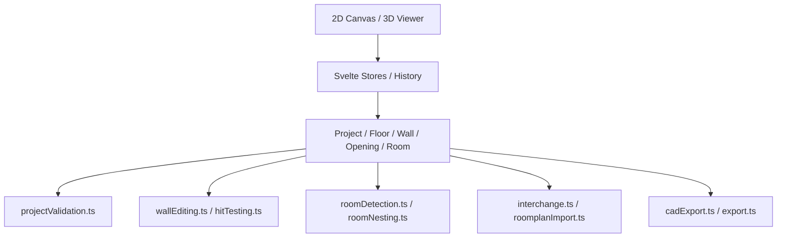
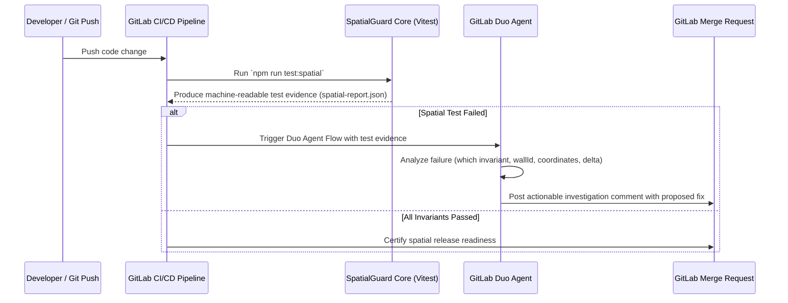

# SpatialGuard — Phase 0 Baseline Audit & Architecture Report

**Date of Audit:** October 26, 2026  
**Auditor / Role:** Senior Software Engineer, Computational Geometry Specialist, Test Automation Architect & DevSecOps Engineer  
**Project:** SpatialGuard — *Every change has a geometry. Every release needs proof.*  

---

## 1. Project Purpose & Scope

SpatialGuard is a quality engineering and release verification system built on top of OpenPlan3D. OpenPlan3D is a browser-based application for designing floor plans in 2D and viewing them in 3D, supporting complex operations on walls, doors, windows, rooms, furniture, multi-floor structures, and multiple interchange formats.

Spatial applications present correctness requirements beyond typical software testing: a project may compile cleanly and pass conventional UI unit tests while silently generating collapsed geometry, orphan openings, distorted interchange transformations, or inconsistent room areas. SpatialGuard establishes deterministic, machine-readable spatial verification designed to be orchestrated by GitLab Duo Agent Platform in future phases.

Phase 0 establishes an evidence-based baseline of the actual repository, architecture, testing infrastructure, geometry rules, and GitLab Duo platform feasibility.

---

## 2. Repository and Fork Information

- **Original Project:** [laanlabs/openPlan3D](https://github.com/laanlabs/openPlan3D) (originally named `open3dfloorplan` by `theLodgeStudio`)
- **Fork Repository:** [MeenalSinha/SpatialGuard](https://github.com/MeenalSinha/SpatialGuard)
- **Git Remote (origin):** `https://github.com/MeenalSinha/SpatialGuard`
- **Active Branch:** `main`
- **Current Head Commit:** `98f9cb4` (*Merge pull request #124 from laanlabs/fix/vite-vitest-advisories*)
- **Target Branch for Delivery:** `main`
- **Pre-existing Working Tree State:** Clean, up-to-date with `origin/main`. No user stashes, untracked changes, or dangling edits were discarded or modified.

---

## 3. License and Attribution Verification

- **Root License File:** `LICENSE`
- **License Type:** MIT License
- **Original Copyright:** `Copyright (c) 2026 theLodgeStudio`
- **Integrity Check:** The MIT license text and original copyright notice are intact and preserved.
- **Package Metadata (`package.json`):**
  - Package Name: `"open3dfloorplan"`
  - Version: `"0.9.0"`
  - License: `"MIT"`
  - Repository URL: `"https://github.com/theLodgeBots/open3dFloorplan.git"` (reflecting upstream genesis)
  - Author: `"theLodgeStudio"`
- **Assessment:** Upstream package metadata reflects historical project naming before renaming to `openPlan3D`. Per Rule 2.5 and Phase 0 Task B, package metadata has been left intact without unnecessary renaming to avoid breaking downstream imports, dependencies, or package-lock structures. Third-party dependencies and assets (e.g. 3D GLB catalog items documented in `MODEL_SOURCES.md` and `docs/furniture-provenance.json`) use permissive open-source licenses (CC0, CC-BY, MIT).

---

## 4. Technology Stack & Environment

| Component | Repository Specification | Verified Local Environment | Status |
| :--- | :--- | :--- | :--- |
| **Node.js** | `.nvmrc` specifies `24` | `v22.19.0` (LTS) | Compatible & operational |
| **npm** | Standard npm (v10/v11 lockfile v3) | `11.6.0` | Compatible |
| **Framework** | Svelte 5 (`^5.57.0`), SvelteKit (`^2.70.3`) | Installed | Verified |
| **Build Tool** | Vite 7 (`^7.3.7`), TailwindCSS (`^4.1.18`) | Installed | Verified |
| **3D Engine** | Three.js (`^0.182.0`), `three-mesh-bvh` | Installed | Verified |
| **Unit Test Runner** | Vitest (`^5.0.5`) with Fake-IndexedDB | Installed | Verified |
| **Browser Runner** | Playwright (`1.63.0`) | Installed (`chromium-headless-shell-1243`) | Verified |
| **CI/CD** | GitHub Actions (`.github/workflows/ci.yml`) | Active upstream workflow | Inspected |

---

## 5. Verified Baseline Build & Test Results

All commands were executed directly in the project environment and recorded honestly:

### 5.1 Dependency Installation (`npm ci`)
- **Command:** `npm ci`
- **Result:** **PASS** (Exit Code: 0)
- **Output:** Installed 332 packages in 31s; audited 333 packages. 3 low-severity advisory overrides handled via `package.json` overrides.

### 5.2 TypeScript & Svelte Diagnostics (`npm run check`)
- **Command:** `npm run check` (calls `svelte-kit sync && svelte-check --tsconfig ./tsconfig.json`)
- **Result:** **PASS** (Exit Code: 0)
- **Output:** `svelte-check found 0 errors and 0 warnings`.

### 5.3 Production Build (`npm run build`)
- **Command:** `npm run build` (calls `vite build`)
- **Result:** **PASS** (Exit Code: 0)
- **Output:** SvelteKit client and SSR outputs generated successfully; `@sveltejs/adapter-node` build finished in 22.29s.

### 5.4 Unit Test Suite (`npm test`)
- **Command:** `npm test` (calls `vitest run`)
- **Result:** **163 Test Files Passed, 1 Failed (1594 tests passed, 2 failed)**
- **Baseline Failure Analysis:**
  - **Failing File:** `tests/skill-examples.test.ts`
  - **Assertion Errors:** Line 76 (`expect(skill.startsWith('---\nname: openplan3d-plan-authoring\n')).toBe(true)`) and Line 82 (`expect(match, 'inline copy of ${name}').not.toBeNull()`).
  - **Root Cause:** Environment-specific Git newline checkout (`core.autocrlf = true` on Windows) checked out `docs/skills/openplan3d-plan-authoring/SKILL.md` with Windows `\r\n` line endings, whereas `skill-examples.test.ts` asserts strict Unix `\n` line endings without normalizing `\r\n`.
  - **Integrity Confirmation:** This failure existed prior to any SpatialGuard changes. Per Rule 2.6 and Phase 0 Task D, this baseline failure is documented honestly rather than concealed. All 163 other test suites pass completely.

### 5.5 Browser E2E Tests (`npm run test:browser`)
- **Command:** `npm run test:browser -- tests/browser/welcome-modal.spec.ts --project=chromium`
- **Initial Execution:** Blocked — Playwright browser binaries were not installed.
- **Remediation:** Executed `npx playwright install chromium` to fetch Chromium headless shell `153.0.8010.12` (v1243).
- **Subsequent Execution:** **PASS** (2 passed, 7.6s). Full browser test execution is supported locally.

---

## 6. Application Architecture & Geometry Data Model Map

The OpenPlan3D core operates around a strongly-typed domain model (`src/lib/models/types.ts`) with coordinates expressed in **centimetres (cm)** for 2D plans and **metres (m)** for 3D/interchange transforms.

### Key Modules and Responsibilities

| Subsystem | Source Path | Primary Functions / Types |
| :--- | :--- | :--- |
| **Data Types** | `src/lib/models/types.ts` | `Point`, `Wall`, `Door`, `Window`, `Room`, `FurnitureItem`, `Floor`, `Project` |
| **Validation** | `src/lib/utils/projectValidation.ts` | `readProject()`, type checks, coordinate finite checks, element ID uniqueness |
| **Wall Geometry & Editing** | `src/lib/utils/wallEditing.ts` `src/lib/utils/wallProfiles.ts` | Endpoint dragging, bezier curved walls (`wallPathProfile`, `wallPathSpans`), wall splitting |
| **Openings (Doors/Windows)** | `src/lib/utils/planOpening.ts` `src/lib/utils/openingDrop.ts` `src/lib/utils/openingPlanBounds.ts` | `planOpening()` (clipping & arc chords), `planWallSpans()` (CAD cuts), `openingDropTarget()` |
| **Room Detection & Areas** | `src/lib/utils/roomDetection.ts` `src/lib/utils/roomNesting.ts` | `detectRooms()`, `resolveRooms()`, `splitWallsAtJunctions()`, `shoelace()`, `roomHoles()` |
| **Interchange (Prepared RoomPlan)** | `src/lib/utils/interchange.ts` `src/lib/utils/roomplanImport.ts` | `projectToRoomPlan()`, `createProjectFromRoomPlan()`, 4x4 matrix transforms, unit conversions |
| **CAD & Document Export** | `src/lib/utils/cadExport.ts` `src/lib/utils/export.ts` | DXF export, SVG paths, PDF generation |

---

## 7. Audit of Existing Geometry Validation & Gaps

| Invariant Category | Existing Validation in Codebase | Existing Test Coverage | Identified Gaps / Failure Modes |
| :--- | :--- | :--- | :--- |
| **Wall Geometry Integrity** | `projectValidation.ts` validates `thickness > 0`, finite endpoints, start/end heights. `splitWallsAtJunctions()` splits walls at intersections. | `tests/wall-editing.test.ts`, `tests/outer-walls.test.ts`, `tests/wall-profiles.test.ts`. | Does not prevent zero-length walls or inverted start/end endpoints during all manual editing paths. |
| **Opening Placement & Attachment** | `projectValidation.ts` checks `walls.has(wallId)`, $0 \le position \le 1$, and $width > 0$. | `tests/plan-opening.test.ts` (clipping curve openings), `tests/curved-wall-openings.test.ts`. | **Critical Gap:** No validation ensures that $width \le L_{wall}$. A 300cm door can be attached to a 50cm wall. Furthermore, no test verifies that opening jamb boundaries $[center - w/2, center + w/2]$ remain strictly within the physical wall domain $[0, L_{wall}]$ for straight walls. |
| **Room Detection & Area Consistency** | `roomDetection.ts` uses planar face-finding with shoelace formula; skips cycles $< 1000\text{ cm}^2$ (0.1 m²); deducts hole polygons. | `tests/rooms.test.ts`, `tests/curved-rooms.test.ts`, `tests/crossing-rooms.test.ts`. | Existing tests verify specific cases, but lack a systematic invariant asserting that arbitrary non-degenerate convex polygons with known dimensions yield exact mathematical area within domain tolerance. |
| **Import/Export Spatial Conservation** | `interchange.ts` converts cm $\to$ m with 8-decimal rounding and 4x4 transformation matrices. | `tests/interchange.test.ts` (JSON structure checks), `tests/sibling-interchange.test.ts`. | **Critical Gap:** Tests focus on JSON properties rather than verifying round-trip geometric conservation: e.g., verifying that after `projectToRoomPlan()` $\to$ `createProjectFromRoomPlan()`, wall lengths, wall angles, opening positions, and room areas are conserved against independent mathematical ground truth. |
| **Save/Reload Persistence** | `projectValidation.ts` runs on read; `datastore.ts` checks IndexedDB. | `tests/project-validation.test.ts`, `tests/projectOpening.test.ts`. | Well covered for schema compliance, but lacks spatial dimension invariant assertions. |

---

## 8. Selected Scope for Phase 1

Based on the empirical audit, two high-value, non-redundant spatial invariants are selected for implementation in Phase 1:

1. **`INV-OPENING-001`: Opening Attachment & Wall Boundary Containment**
   - **Target Property:** Any opening (door or window) associated with a host wall must have a positive width not exceeding the host wall's physical arc length ($0 < w \le L_{wall}$), and its physical jamb span $[center - w/2, center + w/2]$ must reside within the host wall boundaries $[0, L_{wall}]$ (with configurable margin tolerance).
   - **Why Valuable:** Uncovered in existing validation; prevents floating/overflowing doors that produce invalid CAD exports and broken 3D wall mesh cutouts.

2. **`INV-INTERCHANGE-001`: Plan Interchange Spatial Conservation**
   - **Target Property:** Exporting a valid floor plan to prepared RoomPlan JSON via `projectToRoomPlan()` and re-importing via `createProjectFromRoomPlan()` must preserve all geometric properties against independent reference expectations: wall segment lengths, relative opening parameters, opening widths, wall loop enclosure, and calculated room areas.
   - **Why Valuable:** Addresses multi-platform data loss where transformations between 2D cm coordinate systems and 3D column-major metre matrices can distort dimensions or alter room closures.

---

## 9. GitLab Duo Agent Platform Feasibility Audit

### 9.1 Platform Overview & Relevant Capabilities
GitLab Duo Agent Platform provides an agentic execution framework capable of running autonomous multi-step reasoning flows triggered by GitLab CI/CD events, merge requests, or webhook dispatches.
- **Flows Documentation:** [GitLab Duo Agent Platform Flows](https://docs.gitlab.com/user/duo_agent_platform/flows/)
- **Flow Execution:** [Execution Model](https://docs.gitlab.com/user/duo_agent_platform/flows/execution/)

### 9.2 Intended Future SpatialGuard Workflow

### 9.3 Current Environment Status & Blockers
- **GitLab Remotes:** Not currently configured (repository is checked out from GitHub: `https://github.com/MeenalSinha/SpatialGuard`).
- **GitLab CI/CD Configuration:** No `.gitlab-ci.yml` exists yet.
- **GitLab Duo Access:** No GitLab Duo credentials, access tokens, or Duo Enterprise group seat configurations are available in the local shell environment.
- **Actionable Next Steps for Phase 2:**
  - Establish a GitLab remote mirror / project for `SpatialGuard`.
  - Introduce `.gitlab-ci.yml` with a dedicated `spatial-verification` job.
  - Export machine-readable test artifacts (`test-results/spatial-results.json` or JUnit XML).
  - Define the GitLab Duo Flow definition file in `.gitlab/duo/flows/` to consume test artifacts and provide failure root-cause analysis.

---

## 10. Risks and Mitigations

| Risk | Impact | Mitigation |
| :--- | :--- | :--- |
| **Floating-point rounding in coordinate transformations** | False-positive test failures when comparing cm $\leftrightarrow$ m. | Use domain-calibrated, named tolerances ($10^{-3}\text{ cm}$ for linear bounds, $10^{-2}\text{ m}^2$ for area) documented in `INVARIANTS.md`. |
| **Line-ending assertion sensitivity on Windows** | Vitest failures on text file assertions (`\r\n` vs `\n`). | In SpatialGuard tests, parse structured JSON or normalize line endings so tests run reliably across both Linux CI and Windows developer environments. |
| **Decoupling verification from production changes** | Unintended behavioral regressions in OpenPlan3D. | Implement SpatialGuard as a non-intrusive verification module under `src/lib/spatialguard/` and `tests/spatialguard/`, without modifying runtime UI or production stores. |

---

## 11. Explicit Recommendations for Phase 1

1. Create `docs/spatialguard/INVARIANTS.md` specifying exact formal contracts for `INV-OPENING-001` and `INV-INTERCHANGE-001`.
2. Implement the verification harness under `src/lib/spatialguard/` with clean separation between fixture loading, invariant evaluation, and diagnostic reporting.
3. Supply canonical reference fixtures with independently documented ground truth dimensions and areas (not derived from the function under test).
4. Implement deterministic test suites under `tests/spatialguard/` exercising valid cases, negative failure cases, and actionable error messages.
5. Provide a dedicated npm script `npm run test:spatial` that outputs structured JSON / JUnit test evidence for automated consumption.
6. Verify against existing test suites, type checking (`npm run check`), and production build (`npm run build`).
