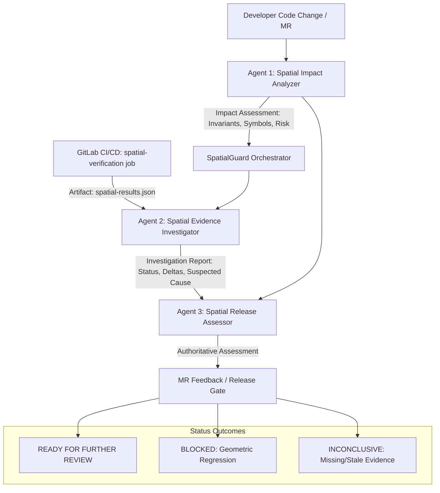

# SpatialGuard Phase 2 — AI Agent Architecture & GitLab Duo Integration

**Document Version:** 2.0  
**Date:** October 26, 2026  
**Status:** Implemented and Locally Validated; Remote GitLab Execution Blocked by Missing Remote/Credentials.  
**Platform:** GitLab Duo Agent Platform & GitLab CI/CD  

---

## 1. Executive Summary & Objective

Phase 2 connects SpatialGuard's deterministic spatial verification foundation (established in Phase 0 and Phase 1) with the **GitLab Duo Agent Platform**. 

In spatial computing applications like OpenPlan3D, conventional code review tools and unit tests cannot reason about spatial regressions: a pull request may introduce valid TypeScript code and pass simple UI unit tests while silently violating physical dimension constraints, breaking interchange transformations, or collapsing room areas.

The objective of Phase 2 is to deploy an evidence-driven, 3-stage agentic workflow that:
1. **Analyzes Code Changes:** Identifies modified files, functions, and symbols, mapping them to concrete spatial invariants (**Spatial Impact Agent**).
2. **Investigates Verification Evidence:** Inspects actual CI test report artifacts (`test-results/spatial-results.json`), correlates failures with code changes, and diagnoses suspected causes with exact metric deltas (**Spatial Evidence Investigator**).
3. **Assesses Release Readiness:** Combines the impact scope and empirical test evidence into an authoritative, structured engineering assessment (`READY FOR FURTHER REVIEW`, `BLOCKED`, or `INCONCLUSIVE`) to guide human reviewers (**Spatial Release Assessment Agent**).

---

## 2. Dependencies on Phase 0 and Phase 1

Phase 2 builds directly upon verified Phase 0 & 1 deliverables without rewriting or mocking existing geometry code:
- **Baseline Audit:** [SPATIALGUARD_BASELINE.md](file:///c:/Users/Meenal%20Sinha/Downloads/SpatialGuard/SPATIALGUARD_BASELINE.md) documenting repository architecture, coordinate systems (centimetres for 2D plans, metres for 3D/interchange), and baseline test metrics.
- **Formal Invariant Contracts:** [docs/spatialguard/INVARIANTS.md](file:///c:/Users/Meenal%20Sinha/Downloads/SpatialGuard/docs/spatialguard/INVARIANTS.md) defining `INV-OPENING-001`, `INV-INTERCHANGE-001`, and `INV-ROOM-001`.
- **Spatial Evaluator & Types:** [src/lib/spatialguard/evaluator.ts](file:///c:/Users/Meenal%20Sinha/Downloads/SpatialGuard/src/lib/spatialguard/evaluator.ts) and [src/lib/spatialguard/types.ts](file:///c:/Users/Meenal%20Sinha/Downloads/SpatialGuard/src/lib/spatialguard/types.ts).
- **Independent Reference Fixtures:** [tests/spatialguard/fixtures/canonical-fixtures.ts](file:///c:/Users/Meenal%20Sinha/Downloads/SpatialGuard/tests/spatialguard/fixtures/canonical-fixtures.ts).
- **Machine-Readable Artifact:** Generated via `npm run test:spatial` into `test-results/spatial-results.json`.

---

## 3. Logical Agent Architecture

The SpatialGuard agent architecture operates as a strictly sequential, evidence-bound pipeline under **supervised autonomy**:



### Agent 1: Spatial Impact Analyzer (`impactAnalyzer.ts`)
- **Objective:** Determine how a set of changed files and code diffs affects OpenPlan3D's spatial behavior.
- **Inputs:**
  - `changedFiles`: Array of modified file paths and git diff hunks.
  - Invariant contract registry ([docs/spatialguard/INVARIANTS.md](file:///c:/Users/Meenal%20Sinha/Downloads/SpatialGuard/docs/spatialguard/INVARIANTS.md)).
- **Analysis Methodology:**
  - Avoids naive keyword matching. Maps files against a verified domain registry:
    - `src/lib/models/types.ts` $\implies$ Core geometry data models (`INV-OPENING-001`, `INV-INTERCHANGE-001`, `INV-ROOM-001`).
    - `src/lib/utils/planOpening.ts`, `openingDrop.ts`, `wallProfiles.ts` $\implies$ Opening placement and boundary containment (`INV-OPENING-001`).
    - `src/lib/utils/interchange.ts`, `roomplanImport.ts` $\implies$ 4x4 matrix transforms and unit conversions (`INV-INTERCHANGE-001`).
    - `src/lib/utils/roomDetection.ts`, `roomNesting.ts` $\implies$ Planar face-finding and shoelace area calculation (`INV-ROOM-001`).
    - Non-spatial files (docs, CSS, i18n, icons) $\implies$ `isSpatialChange = false`, `risk = NEGLIGIBLE`.
- **Output:** `SpatialImpactAssessment` containing impacted invariants, risk classification (`CRITICAL`, `HIGH`, `MEDIUM`, `LOW`, `NEGLIGIBLE`), and recommended test suites.

### Agent 2: Spatial Evidence Investigator (`evidenceInvestigator.ts`)
- **Objective:** Ingest and validate actual spatial test results and correlate failures with code changes.
- **Inputs:**
  - Raw JSON from `test-results/spatial-results.json` (or `SpatialAuditReport`).
  - Pipeline metadata (`commitSha`, `pipelineId`, `timestamp`).
  - `SpatialImpactAssessment` from Agent 1.
- **Validation & Failure Extraction:**
  - Validates evidence presence: returns `MISSING_EVIDENCE` if null/empty, `MALFORMED_EVIDENCE` if invalid JSON, or `STALE_EVIDENCE` if report timestamp predates commit by $> 1\text{ hour}$.
  - Supports native Vitest JSON report schema (`assertionResults`) and SpatialGuard audit schema.
  - Extracts failed assertions, error messages, expected vs actual values, metric deltas, and source code locations.
  - Formulates grounded hypotheses for suspected causes without fabricating nonexistent facts.
- **Output:** `SpatialInvestigationReport` containing verification status (`VERIFIED_PASS`, `CONFIRMED_FAILURE`, `MISSING_EVIDENCE`, `MALFORMED_EVIDENCE`, `STALE_EVIDENCE`), evaluated invariants, and detailed failure diagnostics.

### Agent 3: Spatial Release Assessor (`releaseAssessor.ts`)
- **Objective:** Synthesize impact analysis and empirical test evidence into an authoritative engineering decision.
- **Inputs:**
  - `SpatialImpactAssessment` (Agent 1).
  - `SpatialInvestigationReport` (Agent 2).
  - Merge request / commit context.
- **Assessment Criteria:**
  - **`READY_FOR_FURTHER_REVIEW`:** All required spatial checks passed, no blocking defects detected, and evidence is fresh and complete. *Explicitly noted: This advisory approves the MR for human peer review, not autonomous production deployment.*
  - **`BLOCKED`:** A spatial invariant check failed (`CONFIRMED_FAILURE`). Lists blocking findings with exact delta metrics and root-cause evidence.
  - **`INCONCLUSIVE`:** Evidence is missing, malformed, stale, or an impacted invariant was omitted from the test run.
- **Output:** `SpatialReleaseAssessment` structure suitable for automated posting as a GitLab Merge Request note or CI artifact.

---

## 4. GitLab Duo Custom Flow Configuration

### 4.1 Flow Specification (`.gitlab/duo/flows/spatialguard-investigate.yml`)
The flow adheres to the official GitLab Duo Agent Platform custom flow schema:

```yaml
version: "1.0"
name: spatialguard-investigate
description: "Evidence-driven spatial quality engineering: change analysis, geometry failure investigation, and release readiness assessment for OpenPlan3D."

triggers:
  - event: pipeline.finished
    condition: "pipeline.status == 'failed' || pipeline.has_job('spatial-verification')"
  - event: merge_request.updated
    condition: "merge_request.draft == false"
  - manual:
      command: "/spatialguard investigate"
      description: "Trigger on-demand spatial verification and failure investigation on the current merge request."

context:
  project_id: "${CI_PROJECT_ID}"
  commit_sha: "${CI_COMMIT_SHA}"
  mr_iid: "${CI_MERGE_REQUEST_IID}"
  pipeline_id: "${CI_PIPELINE_ID}"
  artifact_path: "test-results/spatial-results.json"
  invariants_contract: "docs/spatialguard/INVARIANTS.md"

steps:
  - name: spatial_impact_analysis
    type: agent
    role: "Spatial Impact Agent"
    inputs:
      changed_files: "${gitlab.merge_request.changed_files}"
      diff: "${gitlab.merge_request.diff}"
      invariants_spec: "${context.invariants_contract}"
    tools: [repository.read_file, repository.list_files]
    output_key: impact_assessment

  - name: spatial_evidence_investigation
    type: agent
    role: "Spatial Evidence Investigator"
    depends_on: [spatial_impact_analysis]
    inputs:
      impact_assessment: "${steps.spatial_impact_analysis.outputs.impact_assessment}"
      artifact_path: "${context.artifact_path}"
      pipeline_id: "${context.pipeline_id}"
      commit_sha: "${context.commit_sha}"
    tools: [ci.get_job_artifact, repository.read_file]
    output_key: investigation_report

  - name: spatial_release_assessment
    type: agent
    role: "Spatial Release Assessment Agent"
    depends_on: [spatial_evidence_investigation]
    inputs:
      impact_assessment: "${steps.spatial_impact_analysis.outputs.impact_assessment}"
      investigation_report: "${steps.spatial_evidence_investigation.outputs.investigation_report}"
    tools: [merge_request.create_note]
    output_key: release_assessment
```

### 4.2 Project Agent Configuration (`.gitlab/duo/agent-config.yml`)
Configures platform execution mode, tool permissions, and safety boundaries:
- **Autonomy Level:** `supervised`
- **Default Branch:** `main`
- **Permissions:** Read-only access to repository files and CI artifacts; write access limited to posting notes on merge requests (`merge_requests.create_notes: true`). Direct repository write, git push, autonomous merge, and production deployment are strictly disabled.

---

## 5. GitLab CI/CD Pipeline Integration

### 5.1 Pipeline Specification (`.gitlab-ci.yml`)
The CI/CD pipeline defines three stages: `build`, `test`, and `verify`. The dedicated `spatial-verification` job runs `npm run test:spatial` and preserves test artifacts:

```yaml
stages:
  - build
  - test
  - verify

default:
  image: node:22-bookworm
  before_script:
    - node --version
    - npm --version

cache:
  key:
    files: [package-lock.json]
  paths: [.npm/, node_modules/]

spatial-verification:
  stage: verify
  script:
    - npm ci --cache .npm --prefer-offline
    - npm run test:spatial
  artifacts:
    name: "spatial-verification-${CI_COMMIT_REF_SLUG}-${CI_COMMIT_SHORT_SHA}"
    when: always # Retained on both pass and failure for Duo Agent investigation
    expire_in: 7 days
    paths:
      - test-results/spatial-results.json
    reports:
      junit: test-results/junit.xml
  rules:
    - if: '$CI_PIPELINE_SOURCE == "merge_request_event"'
    - if: '$CI_COMMIT_BRANCH == "main"'
    - if: '$CI_PIPELINE_SOURCE == "web"'
```

---

## 6. Demonstrated Verification & End-to-End Test Scenarios

The agent workflow was validated through an automated Vitest suite ([tests/spatialguard/agent.test.ts](file:///c:/Users/Meenal%20Sinha/Downloads/SpatialGuard/tests/spatialguard/agent.test.ts)) with 14 deterministic tests covering all states:

### 1. Happy Path: Code Modification with Passing Evidence
- **Inputs:** `changedFiles: ['src/lib/utils/planOpening.ts']`, actual on-disk `test-results/spatial-results.json` (8 tests passing).
- **Execution:**
  - Agent 1 flags `INV-OPENING-001` (severity: high, risk: HIGH).
  - Agent 2 reads artifact, verifies 8 tests passed, 0 failed across `INV-OPENING-001`, `INV-INTERCHANGE-001`, `INV-ROOM-001`.
  - Agent 3 synthesizes reports $\implies$ Status: **`READY_FOR_FURTHER_REVIEW`**.

### 2. Regression Path: Corner Overflow Door Defect
- **Inputs:** Simulated test report where a door on `wall-s` overflows wall boundaries by 30cm.
- **Execution:**
  - Agent 2 parses failure trace: extracts invariant `INV-OPENING-001`, expected $[0, 400.0\text{ cm}]$, actual $[330.0\text{ cm}, 430.0\text{ cm}]$, delta: $30.0\text{ cm}$.
  - Agent 2 diagnoses: *"Opening position parameter places jamb coordinates past host wall endpoint corners."*
  - Agent 3 flags blocking finding $\implies$ Status: **`BLOCKED`**.

### 3. Safety Path: Missing or Malformed Evidence
- **Inputs:** Null or corrupt report content.
- **Execution:**
  - Agent 2 returns `MISSING_EVIDENCE` / `MALFORMED_EVIDENCE` with `evidenceSufficiency: 'insufficient'`.
  - Agent 3 refuses to approve $\implies$ Status: **`INCONCLUSIVE`** with explicit CI instructions.

---

## 7. Remaining Blockers & GitLab Manual Setup Instructions

### 7.1 Identified Environmental Blockers
- **Git Remote:** The local workspace is currently connected to GitHub (`https://github.com/MeenalSinha/SpatialGuard`). No GitLab remote, project ID, or Duo Enterprise API tokens are present in the local shell.
- **Remote Flow Registration:** GitLab Duo custom flows cannot be registered or triggered until the repository is mirrored or imported to a GitLab instance with the **GitLab Duo Agent Platform** feature enabled.

### 7.2 Manual Setup Procedure for GitLab

1. **Push Repository to GitLab:**
   ```bash
   git remote add gitlab https://gitlab.com/<username-or-group>/SpatialGuard.git
   git push -u gitlab main
   ```
2. **Enable GitLab Duo Agent Platform:**
   - In GitLab, navigate to **Settings > General > GitLab Duo**.
   - Ensure Duo Enterprise is licensed and Agent Platform features are enabled for the project/group.
3. **Register Custom Flow:**
   - Navigate to **Build > Duo Agent Platform > Custom Flows** (or **AI Catalog > Custom Flows**).
   - Select **New Flow from Repository** and point to `.gitlab/duo/flows/spatialguard-investigate.yml`.
   - Alternatively, use Flow Builder to paste the contents of `.gitlab/duo/flows/spatialguard-investigate.yml`.
4. **Trigger Flow on Merge Request:**
   - Create a merge request modifying any file in `src/lib/utils/`.
   - In the MR comments, type `/spatialguard investigate` or observe the automatic trigger when the pipeline completes.

---

## 8. Readiness for Phase 3 (Bounded Remediation)

Phase 2 establishes the complete observational and diagnostic loop. Phase 3 can consume:
1. `investigation.failedChecks[].delta` and `sourceLocations` to generate bounded, deterministic geometric patch proposals (e.g., auto-clamping opening positions or shifting wall endpoints).
2. `SpatialReleaseAssessment` to gate merge requests until proposed remediation patches are verified by regression tests.
