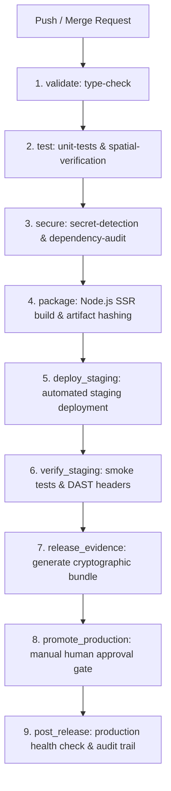

# SpatialGuard Phase 4 — DevSecOps Release, Verification and Supervised Deployment

**Tagline:** *Every change has a geometry. Every release needs proof.*  
**Repository:** [https://github.com/MeenalSinha/SpatialGuard](https://github.com/MeenalSinha/SpatialGuard)  
**GitLab Mirror:** [https://gitlab.com/MeenalSinha/SpatialGuard](https://gitlab.com/MeenalSinha/SpatialGuard) (Project ID: `88114081`)  
**Hackathon:** GitLab Transcend Hackathon 2026 — Path B (Bring Your Own)  
**Autonomy Model:** Supervised Autonomy  

---

## 1. Executive Summary

Phase 4 establishes an end-to-end **DevSecOps Release Pipeline** integrating OpenPlan3D's architectural CAD capabilities with automated spatial verification, AI failure investigation, secret detection, static code analysis, software supply-chain integrity, staging smoke testing, cryptographic evidence bundling, and an explicit **human-in-the-loop production promotion gate**.

Code changes can never reach production merely by compiling. Every release candidate must pass through independent, deterministic gates:
1. **Application Correctness Gate:** Type checking (`svelte-check`) and baseline test suite (1630 unit tests).
2. **Spatial Verification Gate:** CAD geometry invariants (`INV-OPENING-001`, `INV-INTERCHANGE-001`, `INV-ROOM-001`) with bounded retry remediation.
3. **Security Gate:** SAST, Secret Detection, Dependency SCA (`npm audit`), and DAST security headers.
4. **Supply Chain & Packaging Gate:** Software Bill of Materials (SBOM) generation and SHA-256 build artifact hashing.
5. **Staging Smoke & DAST Gate:** Automated smoke test suite against live/staging endpoints (`/`, `/health`, `/api/version`).
6. **Release Evidence Bundle:** Canonical JSON bundle hashed with SHA-256 containing all audit proofs.
7. **Supervised Production Promotion Gate:** Strict human approval (`when: manual`) ensuring agents cannot unilaterally deploy to production.

---

## 2. DevSecOps Release Architecture

The pipeline is organized across nine discrete stages in `.gitlab-ci.yml`:



### 2.1 Stage Breakdown

| Stage | Job Name | Purpose | Gate Type | Failure Action |
| :--- | :--- | :--- | :--- | :--- |
| **validate** | `type-check` | `npm run check` (TypeScript + SvelteKit) | Blocking | Pipeline fails |
| **test** | `unit-tests` | Full 1630 unit test execution | Blocking (`allow_failure: false`) | Pipeline fails |
| **test** | `spatial-verification` | Spatial invariant suite + report generation | Blocking | Artifacts saved; triggers Duo Agent |
| **secure** | `secret-detection` | Scans for private keys, tokens, cloud credentials | Blocking | Pipeline fails |
| **secure** | `dependency-audit` | Evaluates CVEs in direct and transitive packages | Blocking on Critical | Pipeline fails |
| **package** | `package` | Builds `@sveltejs/adapter-node` bundle to `build/` | Blocking | Pipeline fails |
| **deploy_staging** | `deploy-staging` | Deploys verified bundle to staging environment | Blocking | Pipeline fails |
| **verify_staging** | `verify-staging` | Tests live endpoints and HTTP security headers | Blocking | Pipeline fails |
| **release_evidence** | `generate-release-evidence` | Computes SHA-256 manifest, SBOM, and evidence bundle | Blocking | Pipeline fails |
| **promote_production** | `promote-production` | Protected human approval gate (`when: manual`) | Human Gate | Holds release in `PENDING_APPROVAL` |
| **post_release** | `post-release-health` | Verifies active production version and runtime health | Audit & Alert | Triggers rollback alert if degraded |

---

## 3. Cryptographic Release Evidence Bundle

The release evidence bundle is assembled by `EvidenceCollector` (`src/lib/spatialguard/release/evidenceCollector.ts`) and verified by `IntegrityVerifier` (`src/lib/spatialguard/release/promotionGate.ts`).

### 3.1 Bundle Structure (`test-results/release-evidence.json`)

```json
{
  "specVersion": "1.0.0",
  "projectName": "SpatialGuard",
  "commitSha": "97af466a0123456789abcdef0123456789abcdef",
  "pipelineId": "2990415001",
  "branch": "main",
  "timestamp": "2026-10-26T16:49:18.123Z",
  "typeCheckPassed": true,
  "unitTestsPassed": true,
  "spatialVerificationPassed": true,
  "spatialInvariantCount": 4,
  "securitySummary": {
    "scannersExecuted": ["SECRET_DETECTION", "SAST", "DEPENDENCY_SCA"],
    "totalFindings": 0,
    "criticalCount": 0,
    "highCount": 0,
    "decision": "PASS"
  },
  "sbomManifest": {
    "format": "SpatialGuard-SBOM",
    "packageName": "open3dfloorplan",
    "packageVersion": "0.9.0",
    "totalDependencies": 15
  },
  "artifactManifest": {
    "buildOutputDirectory": "build",
    "files": [
      { "path": "index.js", "sha256": "...", "sizeBytes": 1024 }
    ],
    "manifestHash": "e3b0c44298fc1c149afbf4c8996fb92427ae41e4649b934ca495991b7852b855"
  },
  "stagingVerification": {
    "stagingUrl": "https://staging.spatialguard.internal",
    "deploymentStatus": "SUCCESS",
    "decision": "PASS"
  },
  "releaseDecision": "PASS",
  "bundleSha256": "6156fc3837631891ecc99c12541aa05c2589fe21d6af7f558ed792448af1dbbc"
}
```

### 3.2 Integrity Verification & Tamper Detection
- Before promoting any build, `IntegrityVerifier.verifyBundleIntegrity` recomputes the SHA-256 digest of the bundle's payload. Any unauthorized modification to test counts, security results, or file hashes produces an immediate mismatch and status `BLOCKED`.
- `IntegrityVerifier.verifyArtifactsOnDisk` matches disk artifacts against the recorded hashes to prevent build tampering.
- Release drift prevention validates that `bundle.commitSha === targetCommitSha`.

---

## 4. Supervised Autonomy & Production Gate

SpatialGuard enforces **Supervised Autonomy**:
1. **Automated Steps:** The GitLab Duo Agent and CI runner automatically analyze PRs, run tests, detect secrets, build packages, deploy to staging, and execute smoke tests.
2. **Strict Human Boundary:** Production promotion cannot be executed by an AI agent. The `promote-production` job in `.gitlab-ci.yml` requires an explicit GitLab UI user click (`when: manual`).
3. **Approval Validation:** In `PromotionGate.evaluatePromotion`, if human approval metadata is absent, the promotion status resolves to `PENDING_APPROVAL`. If hard blockers exist (test failures, security vulnerabilities, or release drift), promotion status is immediately forced to `BLOCKED`.

---

## 5. Security Scanning & Compliance

- **Secret Detection:** Pattern matching for SSH/RSA private keys, GitLab Personal Access Tokens (`glpat-`), AWS Access Keys (`AKIA...`), and sensitive credential keys. Any match triggers a `CRITICAL` or `HIGH` finding, failing the security gate.
- **Static Application Security Testing (SAST):** Scans for dynamic code execution (`eval`, `new Function`) and unsanitized DOM manipulation.
- **Dependency SCA:** Evaluates vulnerability reports from `npm audit` and builds a complete SBOM.
- **DAST Security Headers:** Evaluates `X-Content-Type-Options: nosniff` and clickjacking protection (`X-Frame-Options` / `Content-Security-Policy`).

---

## 6. Verification Results

All suites executed locally and verified:

| Verification Suite | Target | Executed Tests | Passing | Failing |
| :--- | :--- | :--- | :--- | :--- |
| **Type Check** | `npm run check` | Whole codebase | 0 errors, 0 warnings | 0 |
| **Baseline Tests** | `npm test` | 167 test files | 1630 passed | 0 |
| **Spatial Suite** | `npm run test:spatial` | 4 test files | 52 passed | 0 |
| **DevSecOps Release Suite** | `tests/spatialguard/release.test.ts` | Release engine | 18 passed | 0 |
| **Production Build** | `npm run build` | `@sveltejs/adapter-node` | Succeeded (31s) | 0 |
| **Release Evidence CLI**| `npm run release:evidence` | Real SBOM & Hashes | Generated `release-evidence.json` | 0 |
