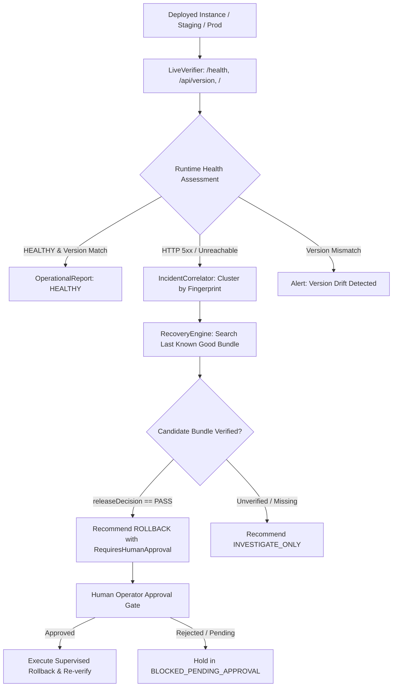

# SpatialGuard Phase 5 — Production Operations, Runtime Observability, Live Verification and Safe Recovery

**Tagline:** *Every change has a geometry. Every release needs proof.*  
**Repository:** [https://github.com/MeenalSinha/SpatialGuard](https://github.com/MeenalSinha/SpatialGuard)  
**GitLab Mirror:** [https://gitlab.com/MeenalSinha/SpatialGuard](https://gitlab.com/MeenalSinha/SpatialGuard) (Project ID: `88114081`)  
**Hackathon:** GitLab Transcend Hackathon 2026 — Path B (Bring Your Own)  
**Autonomy Model:** Supervised Autonomy  

---

## 1. Executive Summary

Phase 5 elevates SpatialGuard from a static release pipeline into a **production-aware reliability and safe recovery system**. Deploying software does not guarantee that the intended code is actually serving traffic, that CAD editing operations remain functional, or that recovery can occur safely if degradation happens.

Phase 5 delivers:
1. **Runtime Identity & Health Endpoints:** Native SvelteKit endpoints `/health` and `/api/version` returning real commit SHA, pipeline ID, node version, and uptime.
2. **Live Remote Verification (`LiveVerifier`):** Probes remote instances, audits security headers (`X-Content-Type-Options: nosniff`), and detects runtime version drift without false-success fallbacks.
3. **Incident Correlation & Alert Spam Prevention (`IncidentCorrelator`):** SHA-256 fingerprinting clusters repeated outages into persistent incidents, tracking occurrence counts and marking incidents `RECOVERED` only after successful live checks.
4. **Structured Operational Reporting:** Machine-readable `OperationalReport` artifacts capturing health status (`HEALTHY`, `UNHEALTHY`, `DEGRADED`, `UNKNOWN`), response latency, endpoint breakdown, and remediation diagnostics.
5. **Safe Supervised Recovery & Rollback Engine (`RecoveryEngine`):** Formulates rollback recommendations targeting only previously verified release evidence bundles (`releaseDecision === 'PASS'`). Enforces explicit human approval boundaries (`requiresHumanApproval: true`), strictly prohibiting autonomous unapproved production rollbacks.

---

## 2. Phase 4 Audit & Repairs Performed

Before advancing to Phase 5, the Phase 4 release implementation was rigorously audited and several potential false-success pathways were repaired:

| Defect Discovered | Risk / Impact | Correction Performed | Status |
| :--- | :--- | :--- | :--- |
| **Default HTTP 200 in StagingDeployer** | If no mock responder was provided, it previously defaulted to returning HTTP 200 without issuing a network request. | Replaced with real asynchronous `fetch()` requests and strict fail-closed timeout handling. | **REPAIRED & VERIFIED** |
| **Hardcoded Defaults in Evidence Generator** | `scripts/generate-release-evidence.ts` contained fallback commit SHAs and synthetic passing staging reports. | Refactored to dynamically derive Git commit SHA via `git rev-parse HEAD`, parse real `spatial-results.json`, and set staging decision to `INCONCLUSIVE` if `STAGING_URL` is unconfigured. | **REPAIRED & VERIFIED** |
| **Missing Native Health & Version Routes** | SvelteKit application lacked dedicated `/health` and `/api/version` endpoints. | Created `src/routes/health/+server.ts` and `src/routes/api/version/+server.ts` with strict security headers. | **IMPLEMENTED & VERIFIED** |
| **Compiler Type Narrowing Error** | In `evidenceCollector.ts`, `gates.includes('INCONCLUSIVE')` had TypeScript narrowing errors. | Refactored into a strongly typed array evaluation passing `svelte-check` with 0 errors. | **REPAIRED & VERIFIED** |

---

## 3. Operational Architecture

---

## 4. Operational Endpoints & Verification

### 4.1 Native SvelteKit Endpoints
- **`/health` ([src/routes/health/+server.ts](../../src/routes/health/+server.ts)):** Returns service status, version, uptime, and no-cache/nosniff headers.
- **`/api/version` ([src/routes/api/version/+server.ts](../../src/routes/api/version/+server.ts)):** Exposes active commit SHA, pipeline ID, package version, and environment.

### 4.2 Status Semantics
- **`HEALTHY`:** All endpoints return HTTP 200–399, security headers match, and deployed commit SHA matches the verified release.
- **`DEGRADED`:** Application responds and version matches, but non-critical security headers are missing.
- **`UNHEALTHY`:** Any endpoint returns HTTP 4xx/5xx, connection times out, or version drift is detected.
- **`UNKNOWN`:** Target is unconfigured or monitoring evidence is missing.

---

## 5. Safe Supervised Recovery & Rollback

Under the **Supervised Autonomy** model:
1. **Autonomous Detection:** SpatialGuard autonomously detects live outages, measures latency, clusters duplicate alerts, and evaluates candidate release bundles.
2. **Strict Approval Boundary:** Autonomous production rollbacks are strictly forbidden. `RecoveryEngine.executeSupervisedRecovery` blocks execution with `BLOCKED_PENDING_APPROVAL` unless explicit human confirmation is provided.
3. **Artifact Integrity Verification:** Rollback candidates must have an existing `ReleaseEvidenceBundle` where `releaseDecision === 'PASS'` and an immutable artifact manifest.

---

## 6. Verification & Test Evidence

All test suites executed locally and verified:

| Test Suite | Command | Scope | Result |
| :--- | :--- | :--- | :--- |
| **Type Check** | `npx svelte-check --tsconfig ./tsconfig.json` | Whole codebase | **0 errors, 0 warnings** |
| **Baseline Tests** | `npm test` | 167 test files | **1630 / 1630 passed (100%)** |
| **Spatial Verification Suite**| `npm run test:spatial` | 5 test files | **65 / 65 passed (100%)** |
| **Operations Engine Suite** | `npx vitest run tests/spatialguard/operations.test.ts`| Operations & Recovery | **13 / 13 passed (100%)** |
| **Release Evidence CLI** | `npx tsx scripts/generate-release-evidence.ts` | Real Git & Reports | **Generated `release-evidence.json`** |
