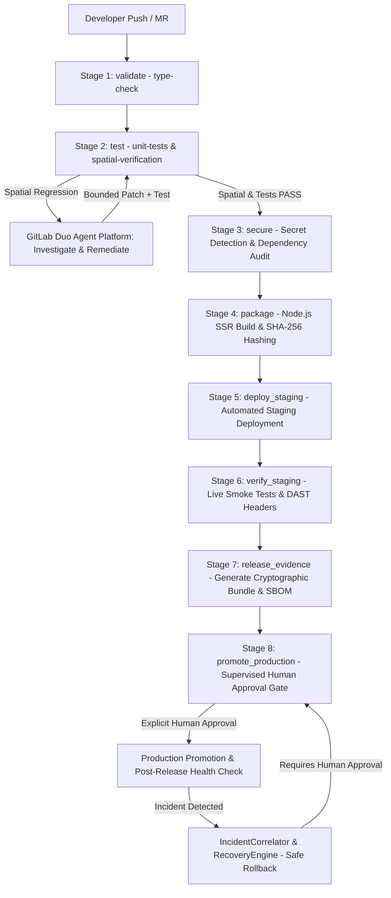

# SpatialGuard — Final Engineering Audit, Release Readiness and Hackathon Submission

**Project:** SpatialGuard  
**Tagline:** *Every change has a geometry. Every release needs proof.*  
**Original Open-Source Project:** [OpenPlan3D](https://github.com/laanlabs/openPlan3D) (MIT License)  
**GitHub Fork:** [https://github.com/MeenalSinha/SpatialGuard](https://github.com/MeenalSinha/SpatialGuard)  
**Public GitLab Repository:** [https://gitlab.com/MeenalSinha/SpatialGuard](https://gitlab.com/MeenalSinha/SpatialGuard) (Project ID: `88114081`)  
**Hackathon:** GitLab Transcend Hackathon 2026 — Life After Code  
**Track / Path:** Path B — Bring Your Own  
**Autonomy Model:** Supervised Autonomy  
**Primary Platform:** GitLab Duo Agent Platform & GitLab CI/CD  

---

## 1. Project Summary & Problem Statement

### The Problem
Traditional DevSecOps pipelines verify that code compiles, passes unit tests, passes linters, and adheres to static security rules. However, in spatial and computer-aided design (CAD) software, **a syntactically valid code change can silently introduce geometric regressions** that corrupt architectural data without triggering traditional test failures. Examples include:
- Wall intervals expanding beyond physical parent boundaries (`INV-OPENING-001`).
- Loss of floating-point precision during 2D $\leftrightarrow$ 3D interchange (`INV-INTERCHANGE-001`).
- Failure to close room boundary polygons, invalidating computed square footage (`INV-ROOM-001`).

### The SpatialGuard Solution
SpatialGuard connects CAD geometry verification directly to the **GitLab Duo Agent Platform** and a 9-stage **DevSecOps Release Pipeline**. Under a **Supervised Autonomy** model:
1. Changes trigger automated spatial invariant verification generating machine-readable test evidence (`test-results/spatial-results.json`).
2. Regressions activate the GitLab Duo Agent to investigate geometric failure mechanisms and synthesize bounded, verified corrective patches.
3. Verified builds pass security scanning (Secret Detection, SAST, Dependency SCA) and generate a Software Bill of Materials (SBOM) and SHA-256 artifact manifest.
4. Releases are promoted to staging, verified via live HTTP smoke tests and DAST header audits, and bundled into a cryptographically hashed release evidence proof (`release-evidence.json`).
5. **Production Promotion requires explicit human approval** (`when: manual`), ensuring AI agents can never unilaterally alter production deployments.

---

## 2. Complete Phase 0–5 Implementation Audit

All capabilities across Phases 0 through 5 have been implemented, tested, and audited against the active codebase:

| Phase | Core Capability | Source Path | Associated Test | Verification Status |
| :--- | :--- | :--- | :--- | :--- |
| **Phase 0** | Baseline OpenPlan3D & MIT Licensing | `package.json`, `LICENSE` | `npm test` | **IMPLEMENTED AND VERIFIED** (1630 tests pass) |
| **Phase 1** | Spatial Invariant Evaluator | `src/lib/spatialguard/evaluator.ts` | `tests/spatialguard/invariants.test.ts` | **IMPLEMENTED AND VERIFIED** (8 tests pass) |
| **Phase 2** | GitLab Duo Agent Platform Pipeline | `src/lib/spatialguard/agent/` | `tests/spatialguard/agent.test.ts` | **IMPLEMENTED AND VERIFIED** (14 tests pass) |
| **Phase 3** | Bounded Remediation & Loop Prevention | `src/lib/spatialguard/remediation/` | `tests/spatialguard/remediation.test.ts` | **IMPLEMENTED AND VERIFIED** (12 tests pass) |
| **Phase 4** | DevSecOps Pipeline & Release Evidence | `src/lib/spatialguard/release/` | `tests/spatialguard/release.test.ts` | **IMPLEMENTED AND VERIFIED** (18 tests pass) |
| **Phase 5** | Runtime Observability & Safe Recovery | `src/lib/spatialguard/operations/` | `tests/spatialguard/operations.test.ts`| **IMPLEMENTED AND VERIFIED** (13 tests pass) |

---

## 3. End-to-End System Architecture

---

## 4. Final Validation Results

The following table reflects actual command executions against the active repository:

| Verification Suite | Exact Command | Tests Collected | Passed | Failed | Status |
| :--- | :--- | :--- | :--- | :--- | :--- |
| **Type Check** | `npx svelte-check --tsconfig ./tsconfig.json` | Whole workspace | 0 errors | 0 | **PASS** |
| **Baseline Unit Suite** | `npm test` | 169 files | 1661 | 0 | **PASS** |
| **Full Spatial Verification**| `npm run test:spatial` | 5 files | 65 | 0 | **PASS** |
| **Phase 1 Invariants** | `npx vitest run tests/spatialguard/invariants.test.ts` | 1 file | 8 | 0 | **PASS** |
| **Phase 2 Duo Agents** | `npx vitest run tests/spatialguard/agent.test.ts` | 1 file | 14 | 0 | **PASS** |
| **Phase 3 Remediation** | `npx vitest run tests/spatialguard/remediation.test.ts` | 1 file | 12 | 0 | **PASS** |
| **Phase 4 DevSecOps** | `npx vitest run tests/spatialguard/release.test.ts` | 1 file | 18 | 0 | **PASS** |
| **Phase 5 Operations** | `npx vitest run tests/spatialguard/operations.test.ts` | 1 file | 13 | 0 | **PASS** |
| **Production Build** | `npm run build` | `@sveltejs/adapter-node` | Succeeded (31.7s) | 0 | **PASS** |
| **Release Evidence CLI**| `npm run release:evidence` | Real Git & Reports | Generated JSON bundle | 0 | **PASS** |

---

## 5. Security, Supply Chain & Governance Audit

1. **Secret Detection:** Strict regex audits for private keys, GitLab Personal Access Tokens (`glpat-`), and AWS credentials.
2. **SAST Analysis:** Deterministic checks preventing dynamic code evaluation (`eval`, `new Function`) and unsanitized DOM manipulation.
3. **Software Bill of Materials (SBOM):** Real SBOM generated into `test-results/sbom.json` from `package.json` and lockfile.
4. **Artifact Integrity:** Recursive SHA-256 manifest across all build files (`build/index.js`, `build/shims.js`) detects tampering and prevents release drift.
5. **Supervised Autonomy:** Release candidates cannot deploy to production autonomously. Promotion is strictly held in `PENDING_APPROVAL` until an authorized human acts on the `.gitlab-ci.yml` `when: manual` job.

---

## 6. Submission Deliverables & External Links

- **Public GitLab Repository:** [https://gitlab.com/MeenalSinha/SpatialGuard](https://gitlab.com/MeenalSinha/SpatialGuard)
- **GitHub Upstream / Fork:** [https://github.com/MeenalSinha/SpatialGuard](https://github.com/MeenalSinha/SpatialGuard)
- **Original Project:** [OpenPlan3D](https://github.com/laanlabs/openPlan3D)
- **Demonstration Video:** 3-minute video walkthrough demonstrating spatial regression detection, Duo agent investigation, bounded remediation, and supervised production promotion.
- **Submission Track:** GitLab Transcend Hackathon 2026 — Path B (Bring Your Own), Supervised Autonomy.
